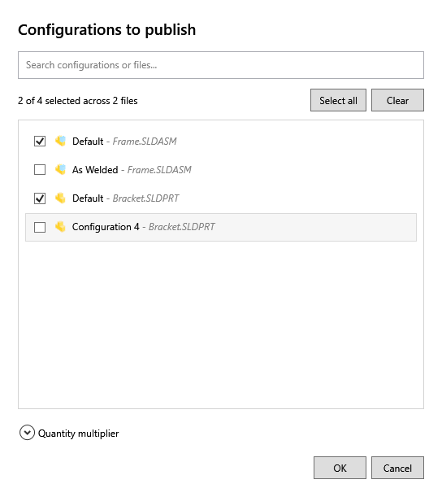

# Ask User to Select Configuration on Task Launch

Enable this option to choose which configurations to publish when launching a task. The dialog lists configurations from every selected part and assembly, with the filename and a SOLIDWORKS icon beside each configuration.

Search by configuration or filename, then check the entries to publish. Select all and Clear apply to the entries shown by the search. Hidden selections are retained.

Each selection belongs to its source file. Selecting `Configuration 4 - Bracket.SLDPRT` processes configuration 4 of that part only. You can select several configurations of the same file. Unchecked configurations are not added by the Convert multiple configurations setting.

The selected entries run sequentially in one task with one combined log. Drawings and other supported input files continue through their normal publishing path. Use the ConfigurationName placeholder in the output filename or folder to keep exports from different configurations separate.

## Quantity multiplier

This section is collapsed by default and its value is 1. Expand it to multiply the bill of materials quantities used by the `(BOMQuantity)` placeholder. For example, a BOM quantity of 2 and a multiplier of 3 produce 6. Enter a value greater than zero.

Select OK to launch the task or Cancel to stop before publishing. If configurations cannot be read, the task reports the affected file instead of silently skipping it.

When Ask User to Specify Files on Task Launch is also enabled, select files first, then choose their configurations here. Scheduled tasks without an interactive file selection use their saved settings.
