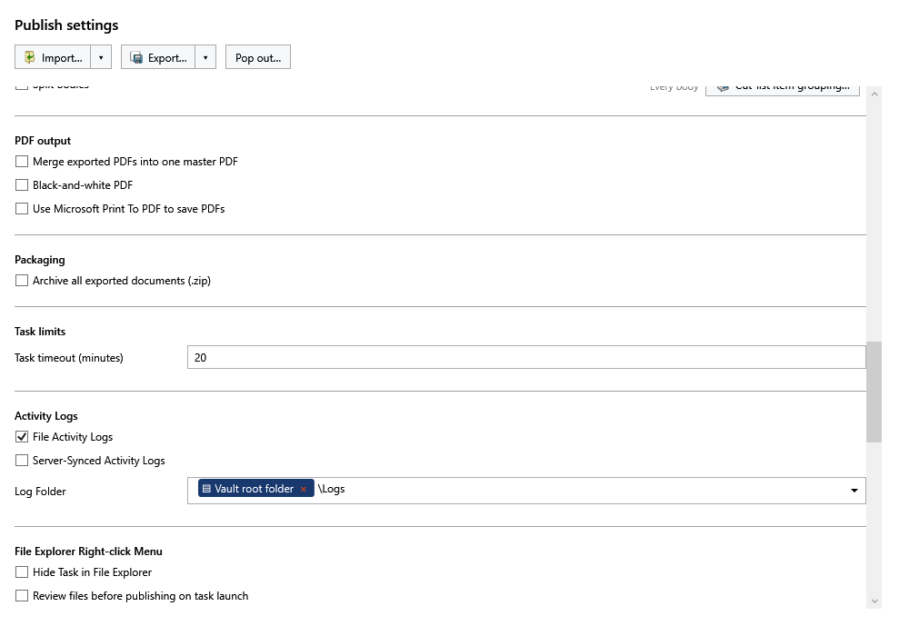

# Black-and-white PDF

In task build **20261129** and later, open **Publish → PDF output** and select **Black-and-white PDF** to remove colored drawing lines from PDF output. The option is **unchecked by default**, including when opening existing task settings.

Select PDF as an export format, then enable this option when a monochrome drawing is required. It applies to both PDF methods:

- **Native PDF export:** temporarily disables SOLIDWORKS's PDF color preference for the export.
- **Microsoft Print To PDF:** temporarily sets the drawing's page setup to black-and-white for printing.

The task restores the prior color setting after the operation, including when export raises an error. Leaving the option off preserves the existing color behavior. This option applies to drawing PDF output; it does not change other export formats or recolor existing PDFs.

See [Microsoft Print To PDF](use-microsoft-print-to-pdf.md) for choosing the PDF method. Test a representative drawing with your task host and chosen method before using the setting in production.
