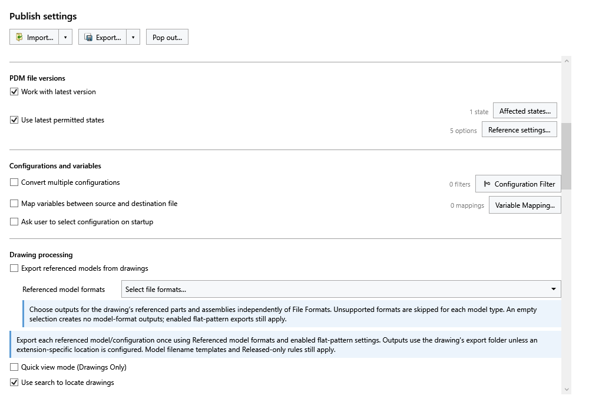
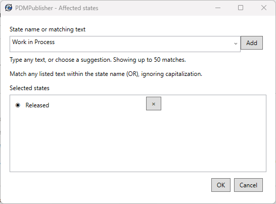
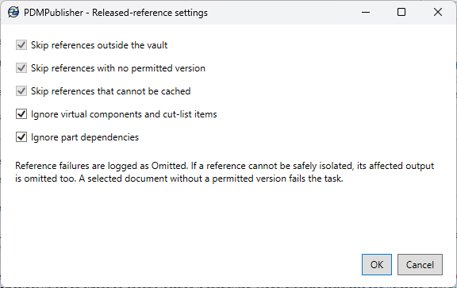

# Use Latest Permitted States Only

Enable Use latest permitted states in the task's Publish settings to select file versions by their PDM workflow state. This overrides Work with latest version and the BOM version selection.

## Affected states

Select Affected states…, type a state name or matching text, and select Add. Suggestions load in the background from the vault's workflows. You can type and add your own text even while suggestions are loading or unavailable. Use X to remove an entry. The count beside the button shows how many entries are selected.

Matching ignores capitalization and uses contains, with OR between entries: any listed text can qualify a state. The default matching text is Released. It matches any state name containing that text, including Unreleased. Choose the matching text carefully; it is not an exact-name check.

For each file, the task selects a version as follows:

1. If the current state matches an entry, use the latest version.
2. Otherwise, search history for the most recent version that entered a matching state.
3. If neither qualifies, apply the top-level or reference rules below.

A file currently in a matching state uses its latest version. A file currently in a nonmatching state uses its most recent qualifying historical version, if one exists.

## Reference settings

Select Reference settings… beside Use latest permitted states. These settings control dependencies of the selected document, such as components of an assembly or the model referenced by a drawing.

All five options start checked. The three Skip checkboxes are checked and disabled intentionally: those reference failures are always omitted and logged. The two Ignore checkboxes are editable. The count beside the button shows the number of enabled options. OK saves your choices; Cancel leaves them unchanged.

### Skip references outside the vault

A reference confirmed to be outside the PDM vault is omitted because the task cannot select a permitted PDM version for it. For example, a Toolbox bolt stored in a local folder outside the vault is excluded from the temporary publishing copy.

The original assembly and external file are not changed. A path that cannot be matched confidently is not automatically classified as outside the vault; the task first attempts to identify it.

### Skip references with no permitted version

A reference is omitted when its current state does not match and its history contains no qualifying version. The task records the filename and reason and continues with other eligible files.

This applies to references. A document selected directly for publishing is a top-level input; if it has no permitted version, it fails validation.

### Skip references that cannot be cached

Caching means retrieving the selected PDM version into the task machine's local vault cache so it can be read for publishing. A reference is omitted if that copy cannot be retrieved or verified—for example, because access is denied or the file cannot be found.

Having some version already on disk does not establish that the required version is available. The task logs the caching or verification failure instead of silently substituting another version.

### Ignore virtual components and cut-list items

When checked, embedded content is handled with its parent rather than checked as a separate PDM file. This includes virtual components and cut-list items identified by their PDM reference type; the task does not infer the type from a name such as `Sheet<1>`.

When unchecked, the task attempts independent checks. A reference that cannot be verified is omitted and logged.

### Ignore part dependencies

When checked, the task validates the parent `.SLDPRT` without independently checking or replacing that part's file dependencies. This applies to any extension, including imported STEP files and referenced SOLIDWORKS parts.

For example, if `Bracket.SLDPRT` depends on `Bracket.step`, the part is checked but the STEP dependency is not independently checked for a permitted PDM state. This does not delete the dependency or prevent SOLIDWORKS from needing it to open the model.

When unchecked, those dependencies are checked too. Assembly components and drawing references continue to follow the normal reference rules in either case.

## What happens when a reference is omitted?

The log records Omitted, the affected filename, and the reason. The task attempts to exclude the failed child from a temporary publishing copy and verifies that copy before exporting. Original files remain unchanged.

Omissions flow downward only. Descendants used exclusively by an omitted branch can also be excluded, but an omitted child does not automatically omit its parent. Shared components can remain eligible through another retained branch. A file selected independently retains its own output eligibility.

The parent continues when its own preparation and verification succeed. If the failed reference cannot be safely excluded, the affected parent output may also be omitted because its preparation failed—not merely because a child failed. Other safe outputs continue.

References discovered later by SOLIDWORKS follow the same settings. Newly discovered vault files undergo version selection and caching; confirmed external references are excluded. The task closes its SOLIDWORKS session before updating the cache for these discovered references.

## When does the task fail?

A selected top-level document with no permitted version fails validation. If a permitted version exists but its copy cannot be cached or safely prepared, that output is omitted. Other export or task errors can still fail processing.

Always review the generated files and task log: an omitted output was not published, even if other processing completed. For identification errors, isolation failures, and the details to include in a support request, see [reference troubleshooting](../options.md#troubleshooting-reference-checks).
