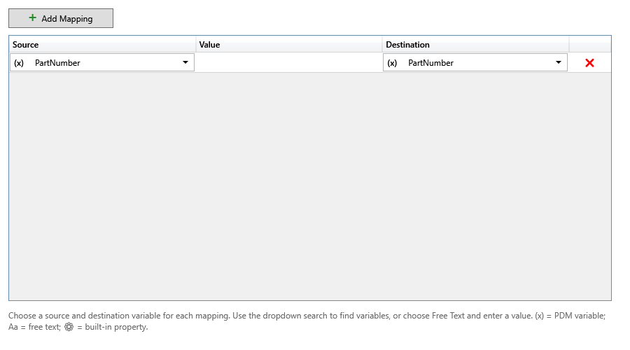
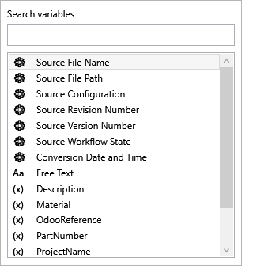

# Map Variables Between Source and Destination File

Enable variable mapping on the PDM task's **Publish** tab to copy metadata to generated files. The searchable controls below are available in task build **20261129** and later. Screenshots use sample variables; your list comes from your vault.

1. Click **Add Mapping** (green **+**).
2. Open **Source**, type any part of a name in **Search variables**, and select a result.
3. Open **Destination** and search for the variable to write on the exported file.
4. To supply a constant instead, choose **Free Text** as the source and enter it in the **Value** cell.

The **Value** column is editable for Free Text. Other sources are evaluated when the task runs; this column is not a preview of their runtime values.

Search ignores capitalization and matches anywhere in the name. Click a result or press **Enter** to select it. **Escape** closes the dropdown without changing the mapping. Clear the search text to show the full list. If nothing matches, the dropdown displays **No matching variables**.

- **(x)** identifies a PDM variable.
- **Aa** identifies Free Text.
- **⚙** identifies a built-in property, such as Source File Name or Source Revision Number.

For example, map **Source Revision Number** to **Revision** to copy the source revision to the exported file. Use the red **×** on a row to remove that mapping.
