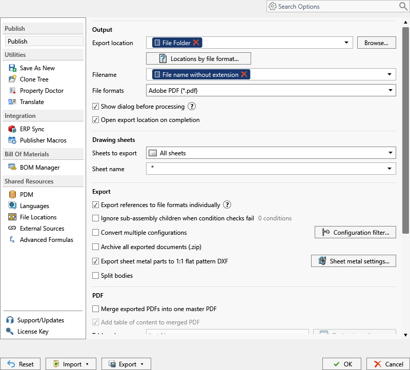

# Merge Exported PDFs into One Master PDF

Combines exported PDFs into a single master PDF.

> [!NOTE]
> This setting is available in both the **PDM task** and **SOLIDWORKS add-in**.

In a PDM task, each top-level assembly produces its own master when its reference list has more than one entry and at least one PDF exports successfully. For example, selecting Assembly A and Assembly B can produce `Assembly A-master.pdf` and `Assembly B-master.pdf` when the filename pattern uses the model name.

A subassembly processed as a reference can contribute drawing pages to its parent’s master. Select the subassembly as a separate task input to produce its own master. A separately selected part or drawing follows its individual export settings.

Required setup:

- Select `PDF` in [File Formats](file-formats.md).
- Enable **Merge exported PDFs into one master PDF**. Enable individual reference exports separately if you also want those files saved.
- Process an assembly: launch the PDM task on an assembly or open the assembly in SOLIDWORKS before publishing from the add-in.

> [!TIP]
> Enable [PDF Bookmarks](pdf-bookmarks.md) and [Add Table of Content to Merged PDF](add-table-of-content-to-merged-pdf.md) when the merged PDF needs navigation.

## Check a task's merge setting

Save **Merge exported PDFs into one master PDF** in PDM Administration, then launch a new task instance. Already queued tasks can retain their previous settings. The log entry **Merge exported PDFs: False** confirms that merging is disabled.

Saving an individual drawing PDF does not mean PDFs were merged.
