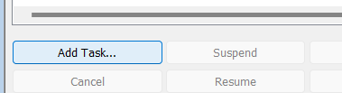

# PDM Task Release Notes

For the other product, see [SOLIDWORKS add-in release notes](pdmpublishersolidworks-release-notes.md).

## 2026.11.17

*Applies to the **PDM Task***

- Added searchable configuration checkboxes for all selected parts and assemblies, with SOLIDWORKS icons and filenames.
- Processes each selected file/configuration pair in one task with a combined log.
- Added a collapsible quantity multiplier section for the BOMQuantity placeholder.

[Configuration selection](pdmpublisher-options/ask-user-to-select-configuration-on-startup.md)

## 2026.11.15

*Applies to the **PDM Task***

- Added an optional second export location with the same placeholder editor and folder browser as the primary location.
- Copies exported files, merged PDFs, and ZIP archives to the second destination without exporting them again.
- Preserves both intended copies during duplicate cleanup and avoids duplicate writes when the destinations match.

[Second export location](pdmpublisher-options/export-location.md#second-export-location)

## 2026.11.14

*Applies to the **PDM Task***

- Added Characters (FileName) to the placeholder menu, with choices for the first 1 to 5 characters of the filename without its extension. Shorter names return all available characters.

[Download PDMPublisher.cex](https://docs.bluebyte.biz/downloads/PDMPublisher.cex) · [Filename character placeholders](pdmpublisherspecialvariable.md#characters-filename)

## 2026.10.29

*Applies to the **PDM Task***

- Unified saved-settings lookup between PDM Administration and task execution. Saving also updates the legacy entry for older task hosts.
- Added startup logging of the settings source, PDF merge setting, and individual reference export setting. Reopen and save the task after upgrading, then launch a fresh instance.

## 2026.10.28

*Applies to the **PDM Task***

- Drawing model exports prefer SOLIDWORKS drawing-view configurations, then PDM configuration, then `@`.
- Released-state matching now accepts any state name containing `Released`, ignoring case, including `Pre-Released` and `Unreleased`.
- Part-to-part dependencies skip independent release checking and caching; assembly components remain validated.
- Hardened task-editor resize handling during opening and closing.
- Task Details can find logs by their instance GUID when saved links are unavailable.

## Drawing model exports and reference matching

*Applies to the **PDM Task***

- Added [Export referenced models from drawings](options.md#export-referenced-models-from-drawings), off by default, with explanatory text beneath the checkbox. Selected 3D formats and enabled part flat-pattern exports use the drawing's referenced configurations and folder rules.
- Released-reference matching now uses the current parent's historical children, including omitted references. Missing extensions resolve only when the child can be identified uniquely; ambiguous errors list the candidates.

## 2026.10.25

*Applies to the **PDM Task***

- Applying font styles to an annotation preserves newly entered text and SQL filename placeholders. SQL query and connection settings survive saving and reopening.

## 2026.10.24

*Applies to the **PDM Task***

- [Cache failures for referenced files](options.md#references-that-cannot-be-cached) are reported as **Omitted** and suppressed in temporary publishing copies. Main selected inputs still must cache successfully.
- Removed omitted files from exports and recalculated retained BOM quantities; shared dependencies remain available through retained branches.
- HRESULT errors use the vault's readable error message. Error locations show only a source filename and line number, without full stack traces.
- [Log filenames](pdmpublisher-options/log-folder-vault-only.md#task-log-filenames-and-retries) use affected document names and the task GUID, with invalid characters removed. Each run clears the prior log text.
- PDM add-in version: `20261024`; assembly version: `2026.10.24.0`.

## 2026.10.23
*Applies to the **PDM Task** — includes changes from task builds 2026.10.19–2026.10.23.*

- Added [task input extension filters](options.md#task-input-file-types), with Part, Assembly, and Drawing checkboxes and an additional-extension dialog. An empty selection allows all file types.
- Cancel interactive launches before queueing when no selected files match. Fixed launch cancellation being overwritten.
- [Released-only publishing](options.md#use-latest-released-versions-only) now identifies cut-list items and virtual components by PDM reference type and skips their independent release checks and caching.
- Reference failures identify the child reference, paths, IDs, type, and the parent's selected Released version instead of incorrectly implying that the parent is unreleased.
- PDM add-in version: `20261023`; assembly version: `2026.10.23.0`.

## 2026.10.18
*Applies to the **PDM Task***

- Updated the PDM add-in and maintenance entitlement version to `20261018`. The corresponding assembly version is `2026.10.18.0`.
- Added activation support for the **PDMPublisher (Trial)** product name while keeping PDM Task and SOLIDWORKS add-in licenses separate.
- Sorted output formats alphabetically in task setup and task-launch format selection.

## 2026.09.33
*Applies to the **PDM Task***

- Rebuilt the [Task Details Log tab](pdmpublisher_task_details.md) as a structured report of saved outputs and failures. It shows totals, timestamps, destination files, PDM versions, source files, and the selected row's details. Existing task logs remain supported.
- Added **Cut-list item grouping** to [Split Bodies](pdmpublisher-options/split-bodies.md). Administrators can continue exporting every body or export one representative body for matching geometry and material in each cut-list item. Grouped filenames include the quantity per part; bodies that cannot be verified are exported separately.
- Fixed task-launch output-format selections and evaluated paths being replaced when publishing started.
- Improved resizing of the Publish and Integrations pages inside SOLIDWORKS PDM Administration.
- Fixed keyboard input in embedded Publish fields and inline annotation editing.
- Made the PDM Task deployment self-contained. Manual deployments must use the complete package, including `PDMPublisher.Merge.exe`, `PDMPublisher.TOC.exe`, their configuration files, and all packaged dependency DLLs.

## 2026.10.09

*Applies to the **PDM Task***

- Added an optional [Integrations task page](task-integrations.md) that can run a configured ERP connector after a successful PDM Task publish job.
- Rebuilt the PDM Task Options interface with a pop-out editor, clearer file-format selection, setting counts, and direct access to Annotations, Conditions, and Scheduled Items.
- Rebuilt the PDM Task annotation editor with direct placement, resizing, inline text editing, formatting, sheet selection, and light/dark theme support.
- Added separate flat-pattern DXF export for each sheet-metal body to the PDM Task.
- Improved the task-launch file and output-format selection dialog.
- Improved PDM Task license activation diagnostics and tied task licensing to the vault name.
- Fixed ERP connector catalog downloads by accepting the trusted legacy `pdmpublisher.com` upload URL through HTTPS and reporting clearer catalog errors.

## 2026.09.08
*Applies to **PDM Task***

- Added [Get latest revision only](/src/pdmpublisher-options/get-latest-revision-only.html). The task can publish the newest recorded PDM revision and the references saved with that revision instead of newer unrevised versions.
- Changed output-copy error handling. If one or more generated files cannot be copied to their destination, the task is now marked as failed instead of completed successfully.
- Added clearer copy-failure log messages with the temporary source path, destination path, and available error details.

## 2026.08.12
*Applies to **PDM Task***

- Fixed the SOLIDWORKS export preferences used when the task creates eDrawings Part (`.eprt`), eDrawings Assembly (`.easm`), and eDrawings Drawing (`.edrw`) files.
- The task now explicitly allows measurement and saves file properties and per-component file properties in supported eDrawings outputs instead of depending on the preferences previously stored on the task host.
- No PDMPublisher for SOLIDWORKS add-in behavior changed in this release. See [eDrawings Export Settings](/src/pdmpublisher-options/edrawings-export-settings.html).

## 2026.08.09

*Applies to the **PDM Task***

- Added **Use drawing-derived BOM**. The task can use the first named BOM saved on an assembly's associated drawing to determine references, configurations, and quantities. If the drawing or a usable derived BOM is unavailable, PDMPublisher falls back to the configured calculated BOM. See [Use Drawing-Derived BOM](/src/pdmpublisher-options/use-drawing-derived-bom.html).

- Changed drawing sheet matching so a multi-sheet drawing with no sheets matching the evaluated pattern exports all sheets instead of producing no sheet output.
- One-sheet drawings continue to export their only sheet without evaluating the sheet-name pattern. See [Sheet Name Pattern](/src/pdmpublisher-options/sheet-name-pattern.html).

## 2026.08.08

*Applies to the **PDM Task***

- Added **File Number** placeholders that return the first 3, 4, 5, or 6 digits from the first numeric sequence in a filename.
- Added **File Number Range** placeholders that group those 3-, 4-, 5-, or 6-digit values into numeric ranges.
- Organized the new placeholders into **File Number** and **File Number Range** groups in the `>...` placeholder menu. See [File Number Placeholders](/src/pdmpublisherspecialvariable.html#file-number-placeholders).

## 2026.08.07
*Applies to **PDM Task***
- Added optional Windows light and dark theme synchronization for PDMPublisher task setup pages. Administrators can turn synchronization on or off from **Add-ins > PDMPublisher > Theme settings...**. See [Theme Settings](/src/pdmpublisher-theme-settings.html).
- Added the `(FileNameNumberRange)` placeholder for organizing numeric filenames into ranges of 1,000. See [File Name Number Range](/src/pdmpublisherspecialvariable.html#file-name-number-range).
- Updated drawing sheet selection so a drawing with only one sheet exports that sheet without applying the sheet-name matching pattern. Sheet-name matching continues to apply to drawings with two or more sheets.

## 2026.08.06
*Applies to **PDM Task***
- Fixed a keyboard focus issue on the Conditions page so users can type in the Value and Configuration columns after adding a condition.
- Made the SOLIDWORKS PDM task setup dialog resizable. The PDMPublisher setup pages now expand with the dialog.

## 2026.08.05
*Applies to the **PDM Task***
- Added ACIS, 3D XML, VRML, VDAFS, CATIA Graphics, HCG, HOOPS HSF, Microsoft XAML, JPEG, TIF, Adobe Illustrator, and Adobe Photoshop export formats. See [File Formats](/src/pdmpublisher-options/file-formats.html).
- Added descriptive format names and Windows file-type icons to the File Formats selector and extension-specific export locations.
- Added visual icons to the BOM template and SOLIDWORKS version selectors.

## 2026.08.04
*Applies to **PDM Task***
- Added a drawing sheet mode selector to control which sheets are exported.
- Added a sheet name pattern field for export modes that filter drawing sheets by name.

## 2026.08.03
*Applies to **PDM Task***
- Improve path normalization, cleanup temp folder.
- Better UNC path handling.
- Add logic to delete temporary folder after successful task run, with error handling and warning message on failure.

## 2026.08.02

## 2026.08.01
*Applies to **PDM Task***
- Fixed bug when creating new tasks (Empty .net framework error dialog)

## 2026.07.27
*Applies to **PDM Task***
- Added (FolderName) for as a condition.

## 2026.07.18
*Applies to **PDM Task***
- Fixed issue related to PDM failing to add files during check-in (E_EDM_FILE_SHARE_ERROR: HResult 0x8004020B) 
- Fixed issue related to creating TOC table when the character '#' is used.

## 2026.06.21
*Applies to **PDM Task***
- Added an interactive task launch file selection dialog for tasks that ask users to specify files at launch.
- Added CSV import to the task launch dialog. PDMPublisher reads file names or paths from the CSV, searches the vault, and uses the first matching result while skipping duplicates.
- Added automatic assembly reference calculation in the launch dialog.
- Added view-only drawing rows under parts and assemblies. These rows are shown for review but are not passed to the task input list.
- Added launch-time file format selection, export location visibility, and an administration notice that explains task export settings are controlled from the SOLIDWORKS PDM Administration tool. See [Scheduled Items Task Page](/src/scheduleditems.html).

## 2026.06.20
*Applies to **PDM Task***
- Added the **Scheduled Items** setup page. This page lets administrators choose files that PDMPublisher should process when a scheduled task runs without selected files. See [here](/src/scheduleditems.html).
- Added support for exporting Parasolid binary files with the `x_b` extension.
- Updated Scheduled Items task-run handling and task details log lookup behavior.

## 2026.05.31
*Applies to the **PDM Task***
- Hot fix: PDF not printing due to split bodies.

## 2026.05.30

*Applies to the **PDM Task***

- Added a log page in the details tab. See [here](/src/pdmpublisher_task_details.html).
- Added support for splitting multi-body part. See [here](/src/options.html).
- Limited `u3d` extension to assemblies export only.
- Fixed a bug when clicking on Add Task in the administration tool under Task List. The task now asks the user to select which files to process:

## 2026.05.01
*Applies to **PDM Task***
- Improved retry count and wait time between retries during file checkin and file add.

## 2026.04.21
*Applies to **PDM Task***
- Added feature to suppress task commands in the tasks right-click menu in File Explorer. Setting is in options.

## 2026.04.17
*Applies to **PDM Task***
- Fixed issue related to sheet metal exports (views)

## 2026.04.12
*Applies to **PDM Task***
- Small bug fixes

## 2026.04.11
*Applies to **PDM Task***
- Fix bug when export location starts with `//`

## 2026.04.10
*Applies to **PDM Task***
- Added retry when adding files and checking files back into the vault.

## 2026.04.01
*Applies to **PDM Task***
- Added support for exporting views of sheet metal parts
- Added check-in retry
- Added extra logging to find when exported files are locked by other applications

## 2026.03.26
*Applies to **PDM Task***
- Add custom quantity multiplier when the user is asked the configuration on startup.
- Added Download Center menu item in the Administration tool under the add-in for when PDMDeploy is blocked. This will take you to the PDMPublisher download center.

## 2026.03.22
*Applies to the **PDM Task***
- Merge and TOC bugs fixes.
- Added support for exporting to `bmp`

## 2026.03.16
*Applies to **PDM Task*** 
- Added support for processing excel and word files to pdf 
- Added support for variable mapping between the destination file and the source file 
- Added support for creating a custom reference between the destination file and the source file 
- Added support for deleting duplicates outside the target destination
- Added support for the following extensions: `ifc`,`3mf`, `3dpdf` (pdf but for the parts and assemblies) 
- Minor bug fixes

## 2026.02.23
*Applies to the **PDM Task***
- Fixed bug when exporting flat pattern when `Convert Multiple Configurations` is enabled
- Added new option under Flat Pattern Settings to remove or add `-FlatPattern` to the dxf flat pattern filename.

## 2026.02.22
*Applies to the **PDM Task***
- Added support for filtering configurations to task enabled via the `Convert Multiple Configurations`
- Added support for the `3mf` extension for parts

## 2026-02-09 
*Applies to the **PDM Task***
- Started used seperator | instead of # (Caused issues with filenames containing #)
- Updated FAQ about merging PDFs error.
- Added `ConfigurationName` alias to conditions.

## 2026-01-17  
*Applies to the **PDM Task***
- Fixed  **outside diameter of countersink holes** when exporting **DXF flat patterns** bug.

## 2026-01-15  
*Applies to the **PDM Task***

- Added a new **Flat Pattern export setting** that removes the **outside diameter of countersink holes** when exporting **DXF flat patterns**: This helps produce cleaner DXFs for downstream manufacturing by excluding countersink outer geometry while preserving required cut profiles.

