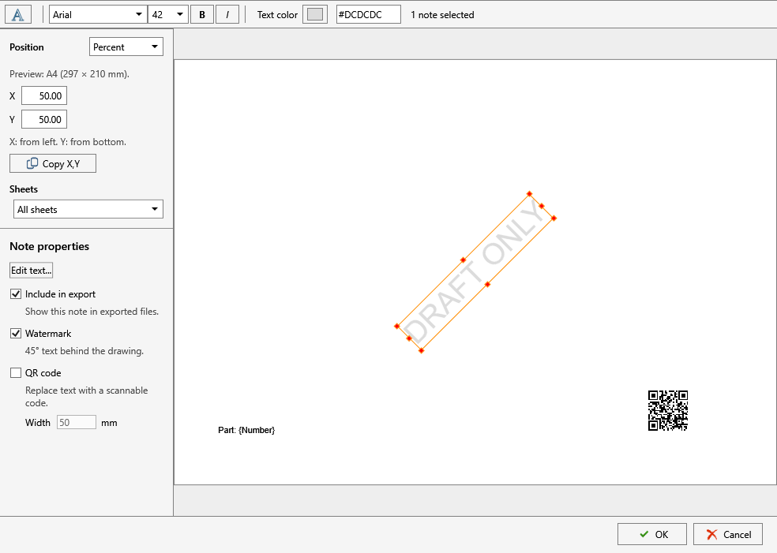
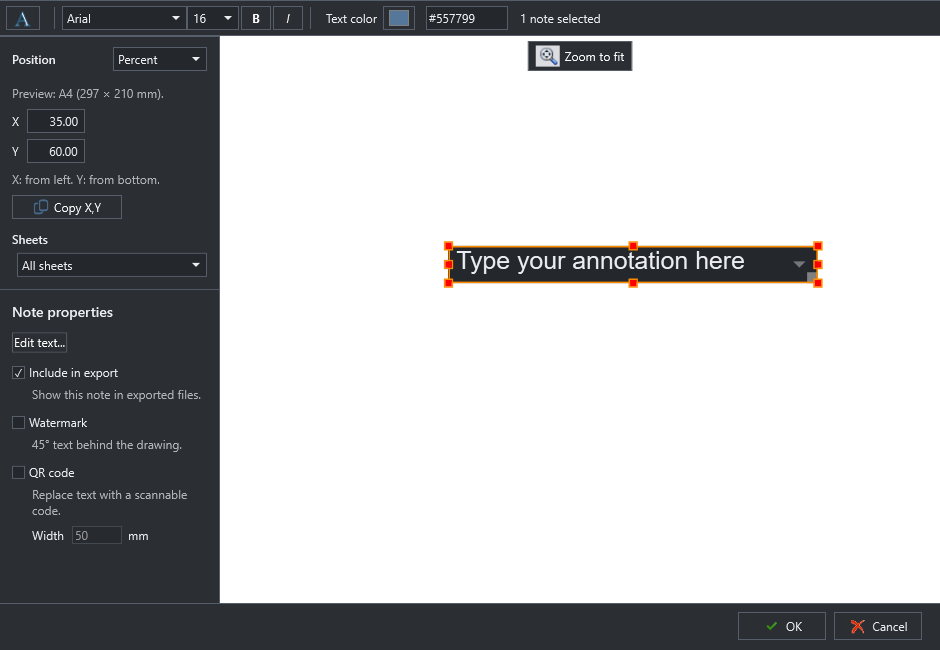

# Publishing Annotations

Annotations belong to the selected publishing profile. Open **PDMPublisher > Annotations** to edit them. The active drawing supplies the positioning background.

Select a note to show its properties sidebar. Click empty space to hide the sidebar and use the full preview area.

- Use **A** to add a note. Select **Edit text...** in its sidebar or double-click the note to edit its text or insert a property from the dropdown. Drag the editor edges to resize the editing box.
- Choose the font, point size, bold, italic, and text color on the toolbar. Click the color swatch or type a complete `#RRGGBB` color.
- Set **Position** to percent, millimeters, or inches. X is measured from the left and Y from the bottom; a watermark uses its center as the anchor.
- **Include in export** keeps or omits the note without deleting its definition. **Sheets** selects all sheets, the first sheet, or named sheets.
- **Watermark** rotates the note's text 45 degrees behind the drawing. It starts gray; you can change the color. Clearing Watermark keeps the text styling. Image and logo watermarks are not supported.
- **QR code** renders the note as an image. Double-click to edit its text. Width is in inches when inch positioning is selected, otherwise millimeters—never percent. Placement accounts for the image size so the preview and exported QR use the same bounds.
- Press **Ctrl+A** outside text editing to select every note, then **Delete** to remove them.

## Zoom and pan

Use the mouse wheel over the sheet to zoom around the pointer. Hold the middle mouse button and drag to pan. Click the centered **Zoom to fit** button to fit the sheet back into the preview.

Selecting an annotation keeps the displayed sheet scale when its properties sidebar opens. Clicking **Zoom to fit** while editing keeps the text editor open and returns focus to it.

Zoom only changes the preview. Saved coordinates, text point sizes, QR widths, and PDF output sizes are unchanged. Text-editing carets are white in dark mode and black in light mode.

Property placeholders are evaluated when publishing. The QR preview encodes the template text; the exported QR code encodes the evaluated value.

**Custom properties** lists document and configuration properties from loaded drawings and models. Publishing uses the associated/reference model and its configuration, falling back to file-level properties. The menu does not bind a placeholder to a particular model.

Choose **OK** to save the profile or **Cancel** to discard the edits. Temporary publishing annotations are removed from the source drawing after export. Watermark cleanup refreshes the sheet format and returns to normal sheet mode without saving the drawing.
