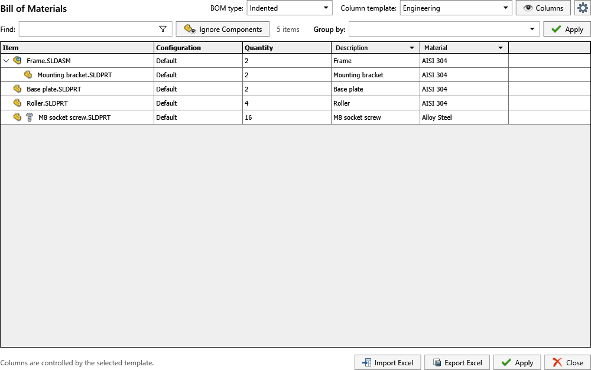
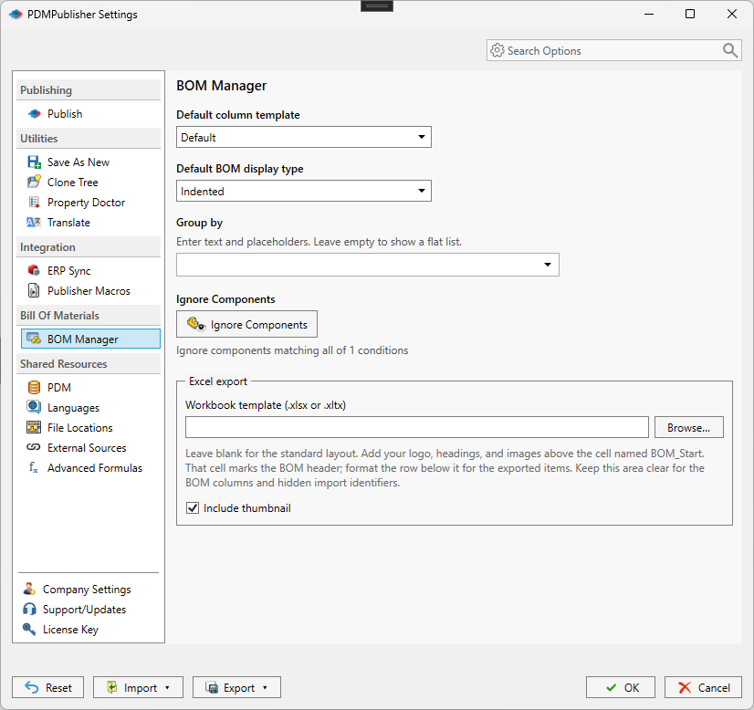
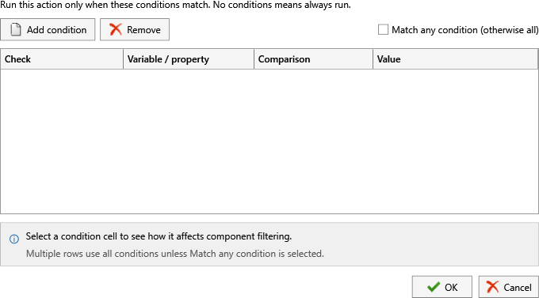

# BOM Manager

Open **PDMPublisher > BOM Manager** to review and work with the bill of materials for the active assembly or a part containing weldment or sheet-metal cut-list items.

The main window provides the BOM type and column-template selectors, property columns, find and filtering controls, grouping, component exclusions, Excel import and export, and **Apply**. Select the gear button to open the persistent BOM Manager settings described below.

Open **PDMPublisher > Settings > BOM Manager** under **Bill Of Materials**.

BOM Manager defines the default structure used when PDMPublisher produces or displays bill-of-material information.

| Setting | What it controls |
| --- | --- |
| **Default column template** | Selects the saved set and order of BOM columns. |
| **Default BOM display type** | Selects the SOLIDWORKS BOM structure, such as an indented hierarchy. |
| **Group by** | Groups rows by text, properties, or placeholders. Leave it empty for a flat ungrouped result. |
| **Ignore Components** | Opens the condition editor used to omit matching components from the BOM. |
| **Workbook template** | Selects an optional `.xlsx` or `.xltx` template for Excel exports. Enter the path or select **Browse...** beside the field. |
| **Include thumbnail** | Includes the available model thumbnail in the exported workbook. |

## Weldment and sheet-metal parts

Open a part with a populated cut list, then choose BOM Manager. Use Indented to show the part and its cut-list items. Each cut-list row shows its quantity and cut-list properties. The Weldments and Sheet Metal filters control which items are displayed.

Cut-list rows use generic weldment or sheet-metal thumbnails. Normal part and assembly rows keep their document previews.

## Save column templates

Column templates store the columns to display and their order. Use the Column template dropdown in BOM Manager to switch between saved templates.

1. Select a template and open Columns.
2. Check the columns to include and arrange their order with Move up and Move down.
3. Choose Save As, then enter a unique template name.
4. Select Use by default if you want this template selected by default.
5. Select Save. The new template becomes selected in BOM Manager.

Save As preserves the original template. To update the selected template, choose Save directly in the column editor. Cancel discards the changes. Duplicate template names are rejected.

## Evaluated property values

BOM Manager retains evaluated custom-property values, including empty results, without substituting the stored expression. The displayed values are also used for grouping, exports, and ERP Sync snapshots.

## Configure the defaults

1. Select a **Default column template**.
2. Select the **Default BOM display type** appropriate for the assembly structure.
3. If rows should be grouped, enter a **Group by** expression and use its placeholder menu to insert document values.
4. Select **Ignore Components** to define exclusions. Choose whether any condition or all conditions must match, then add the required property rules.
5. For Excel exports, enter an optional **Workbook template** or select **Browse...** to choose one.
6. Enable **Include thumbnail** when exported BOM rows should include model previews.
7. Select **OK** to save the settings.

Exclusion conditions affect BOM membership; they do not suppress or delete components in the SOLIDWORKS assembly.
