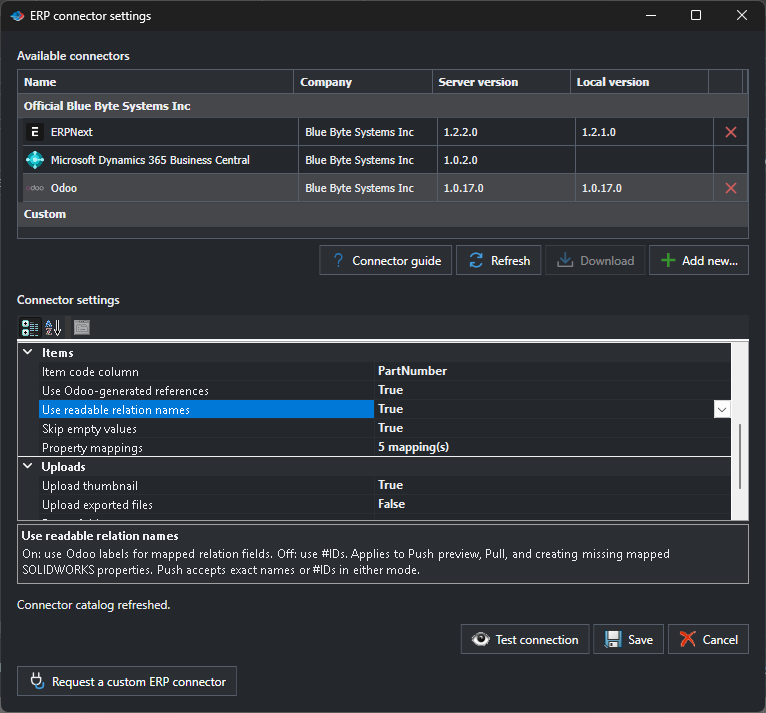
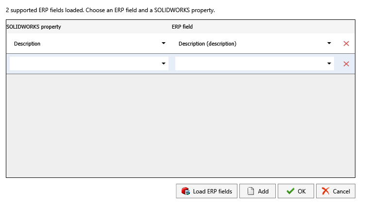

# Odoo Connector

Use Push to send selected SOLIDWORKS items to Odoo. Use Pull to bring mapped product values into SOLIDWORKS.

## Connect to Odoo

You need Odoo 19 or later with JSON-2 external API access. The Odoo user needs permission to read products and to make the changes you plan to publish.

1. In Odoo, open My Preferences > Security > API Keys. Create a key with the `rpc` scope and copy it.
2. In SOLIDWORKS, open PDMPublisher > Settings > ERP Sync. Open the connector settings, select Odoo, and choose Download if needed.
3. Enter the server URL and API key. Leave Database empty unless your server requires a database name.
4. Select Test connection, then Save.

## Match products and map properties

Under Items, set Item code column to the SOLIDWORKS property that holds the Odoo Internal Reference. The default is `PartNumber`. Each reference must identify one Odoo product.

Open Property mappings and pair each SOLIDWORKS property with a writable Odoo field. For example, map Category to `categ_id`. Select Load ERP fields to refresh the list after adding a field in Odoo.

Use readable relation names is on by default. Push preview and Pull show labels such as `Goods`. Turn it off to use record IDs such as `#6`. Push accepts either an exact, unique label or an ID. If a label is ambiguous, Pull keeps the ID. To convert IDs already stored in SOLIDWORKS, turn the option on, run Pull, and select Apply to SOLIDWORKS.

Enable Skip empty values to preserve existing values when the source is blank. If a mapped property is missing in SOLIDWORKS, Push can create it using the existing product's value or, for a new product, the Odoo default when available. The readable names setting applies here too.

## Generate part numbers

If Odoo assigns Internal References, enable Use Odoo-generated references and choose a writable SOLIDWORKS property for Item code column. When Push creates a product for a row with a blank item code, it writes the returned reference to that property.

In Settings > ERP Sync, Save generated part numbers to lets you choose one number per file or one per configuration. Write mapped properties to (Push and Pull) separately controls where other properties are written.

## BOM types

Under Push > Sync BOM, choose Manufacture this product, Kit, or Subcontracting. To create a subcontracting BOM, select an existing Odoo subcontractor. Review component and quantity changes before committing.

## Review and apply

For Push, select the rows and operations, review the changes, then choose Commit changes. To include existing exports, enable Upload exported files and choose the folder and extensions. Files must share the source model's base name.

For Pull, review the proposed values, choose Apply to SOLIDWORKS, then save the modified documents. To inspect a matched product in your browser, select its cell and choose Open in Odoo.

If a row is omitted, the report gives the reason. A missing component reference can also cause the parent BOM update to be skipped.

[ERP Sync settings and review controls](pdmpublishersolidworks_erp-sync.md)
